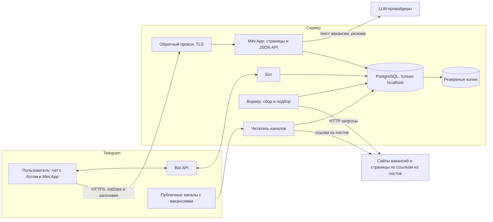

# Модель угроз HunterKitty

Версия 18.11.2026. Метод: схема потоков данных, границы доверия, STRIDE по каждой границе, затем список главных рисков со статусом.

## Что за система
Telegram-бот и Mini App для поиска работы. Сервис собирает вакансии с сайтов и из Telegram-каналов, подбирает их под фильтры человека, присылает уведомления, пишет сопроводительные письма через LLM и проверяет резюме. Около 230 пользователей, один Linux-сервер.

## Схема потоков данных

## Границы доверия
| № | Граница | Что пересекает |
|---|---|---|
| B1 | Интернет и Telegram → обратный прокси | запросы Mini App, вебхуки оплат |
| B2 | Страница Mini App → API | initData, фильтры, тексты «О себе», файлы резюме |
| B3 | Чужой контент → сбор | вакансии, посты каналов, страницы по ссылкам: их пишет кто угодно |
| B4 | Сервис → LLM | текст вакансии и резюме уходят модели, ответ модели возвращается людям |
| B5 | Процессы сервиса → ОС | секреты в `.env`, база, резервные копии, другие учётные записи на сервере |

## Ценности
- Личные данные пользователей: tg id, имя и ник, «О себе» и резюме, фильтры, сохранённые вакансии.
- Токен бота: им подписывается initData, с ним можно войти за любого пользователя.
- Сессия учётной записи, которая читает каналы.
- Ключи LLM-провайдеров, пароль базы.
- Доверие пользователей: в ленту не должны попадать мошеннические «вакансии».
- Доступность: лимиты Telegram и внешних сайтов, капчи.

## STRIDE
| Угроза | Где | Как защищено | Статус |
|---|---|---|---|
| **S** Подмена пользователя | B2 | подпись initData HMAC-SHA256, сравнение за постоянное время, возраст до 24 ч, не из будущего ([HK-02](../findings/HK-02-initdata-future-date.md)), id только из подписи | есть; повтор строки в пределах суток: [HK-11](../findings/HK-11-initdata-replay.md), принятый риск с планом |
| **S** Привилегии по нику | бот | бесплатный доступ друзьям по tg id, а не по нику ([HK-06](../findings/HK-06-pro-by-username.md)) | исправлено |
| **T** Изменение чужих данных | B2 | каждый запрос к строке выдачи проверяет владельца, 404 на чужую; негативные тесты по всем 33 маршрутам | есть; событие статистики без проверки владельца: [HK-12](../findings/HK-12-apply-event-id.md), без влияния на данные |
| **T** SQL injection | B2 → DB | только SQLAlchemy с параметрами; тест-сторож на склейку SQL в коде; API-тесты с инъекциями через все поля ввода | есть |
| **T** Внедрение инструкций в LLM | B3 → B4 | вакансия передаётся модели как данные в теге, ответ чистится от чужих ссылок и контактов ([HK-01](../findings/HK-01-prompt-injection.md)) | исправлено |
| **T** XSS из чужого контента | B3 → B2 | вывод как текст, CSP без inline-скриптов, только `http(s)` ссылки ([HK-07](../findings/HK-07-javascript-links.md), [HK-08](../findings/HK-08-security-headers.md)) | есть |
| **R** Отказ от действий | все | события пользователя и оплат пишутся в базу с временем, статус оплаты подтверждается запросом к API провайдера, а не по уведомлению на веру | есть (платежи сейчас выключены) |
| **I** Утечка личных данных через API | B2 | доступ только к своим строкам, `Cache-Control: no-store`, `Referrer-Policy` | есть |
| **I** SSRF из ссылок в постах | B3 | только публичные адреса, проверка каждого редиректа и адреса при соединении ([HK-04](../findings/HK-04-ssrf.md)) | исправлено |
| **I** Утечка секретов | B5 | секреты только в `.env` с правами владельца сервиса, не в коде и не на клиенте; база слушает только localhost | есть |
| **I** Резервные копии | B5 | копии базы ежедневно, хранятся 14 дней | частично: не шифруются, доступ к ним нужно сузить; в плане |
| **D** Флуд API | B2 | лимит запросов на пользователя (429), лимиты отзывов, писем и проверок резюме ([HK-05](../findings/HK-05-letters-race.md)) | есть |
| **D** Блокировка внешних источников | WRK | потолок запросов мгновенного поиска ([HK-09](../findings/HK-09-unbounded-hh-requests.md)), паузы, остановка источника при капче | есть |
| **D** Лимиты Telegram | BOT | общий ограничитель массовых отправок (до 20 сообщений в секунду, одному человеку не чаще раза в секунду), пропуск заблокировавших бота | есть |
| **E** Повышение прав | B2, бот | админ-функции проверяют tg id владельца на сервере; список полей фильтров закрыт белым списком | есть |
| **E** Уязвимые зависимости | все | ручной разбор версий; автоматическое сканирование подключается | в работе |

## Главные риски
| Риск | Вероятность | Ущерб | Статус |
|---|---|---|---|
| Утечка токена бота: вход за любого пользователя | низкая | высокий | токен только на сервере; при утечке смена токена отзывает все подписи |
| Мошеннические вакансии в ленте | высокая | средний | классификатор с жёстким списком «точно не вакансия», жалобы пользователей разбираются |
| Повтор перехваченной initData | низкая | средний | HK-11: план своей короткой сессии |
| Резервные копии без шифрования | низкая | высокий | в плане: шифрование и сужение доступа |
| Prompt injection через чужие тексты | средняя | средний | два слоя защиты, ретест на модели запланирован |
